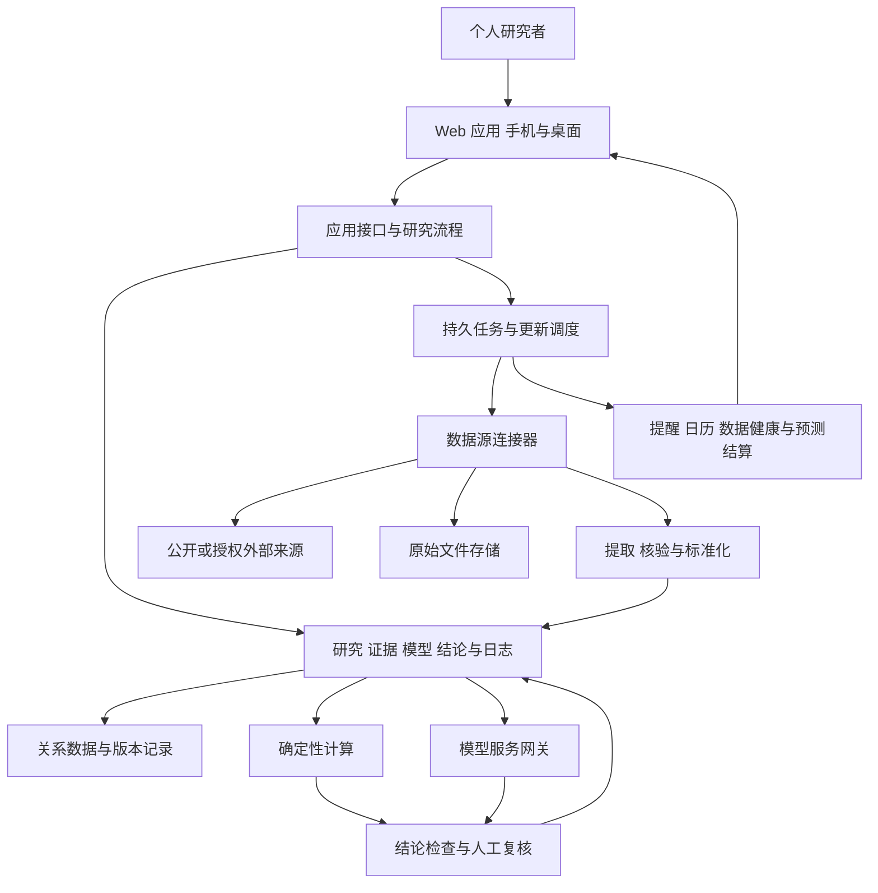

# Personal Financial Analyses 方案与技术设计

版本 0.3
日期 2026年10月25日
状态 研究体系设计基线，本地首版已实现部分能力

本方案将[用户需求](requirements.md)和[研究与决策规程](research-methodology.md)转化为可实施的系统设计。研究流程、证据和判断规则是系统主干。下文技术结构为建议默认值，具体框架、供应商、预算和生产部署仍可在实施时调整。

0.2的实际实现为Python模块化单体、原生响应式Web、SQLite持久记录与任务。与原PostgreSQL建议的调整见[ADR0001](decisions/0001-local-runtime.md)。已实现范围和未完成项以[运行指南](local-development.md)和[首版验收](validation/local-v0.2.md)为准，下文完整领域对象仍包含后续设计。

0.3经实际自审下调当前允许用途，增加本地后台服务、健康检查、内核/原件依赖、证据类型与期间门槛及反例验证。每项功能按[质量合同](quality/feature-plan.md)实施；[自查判定](quality/review-2026-10-25.md)优先于“流程完成”的概括，不将当前通用情景称为已验证的个股盈利估值。

## 设计结论

1. 用明确的研究问题组织工作，支持首次覆盖与事件更新两种路径。
2. 信息、解释、预测、估值和行动分别保存，通过版本和依赖关系连接。
3. 关键证据缺失时，系统主动安排补证、限制结论或停止研究。
4. 统一数据与过程规则，按行业和策略选择模型；不生成通用公司总分。
5. 使用可复算的财务计算；AI提出解释、提取候选和审查意见，不能直接创造已核验事实。
6. 结论方向、解释信心、预测概率、估值稳健性与账户适宜性分别表达。
7. 少量真实对象先覆盖完整流程，再扩大覆盖和自动化程度。

## 架构默认方案

首期建议采用模块化单体与独立后台任务。单用户研究可以在本地开发环境运行，数据模型保留用户和工作区归属。手机适配与桌面深度研究共用 Web 应用。前端、后端框架和模型服务提供者尚未冻结，由实施者依据环境和部署决定记录。

### 组件职责

| 组件 | 职责 | 主要约束 |
| --- | --- | --- |
| Web 应用 | 研究队列、公司档案、证据、模型、结论、修改与复核 | 手机可读；数据时点和准备程度可见 |
| 研究流程模块 | 状态转换、关键缺口、补证优先级和完成条件 | 不因任务结束就自动形成投资结论 |
| 连接器 | 按来源规则获取元数据、原文、字段或行情 | 权限、限额、重试、版本和健康状态分别记录 |
| 提取与标准化 | 结构化字段、页码、单位、实体和期间校验 | 提取候选与已核验事实分开 |
| 计算模块 | 利润现金勾稽、累计转单季、敏感性与估值 | 有版本输入、公式、单位和可重现结果 |
| 模型服务网关 | 受证据约束的提取、竞争解释、研究任务和反方意见 | 输出校验、费用记录；来源内容不作为系统指令 |
| 发布与复核 | 检查结论范围、关键依据、分歧与人工修改 | 结论记录复核状态；修改追加版本 |
| 后台任务 | 获取、核验、更新、重算、提醒和结算 | 幂等、持久、可恢复；失败不静默 |

### 存储选择

关系数据建议使用 PostgreSQL，金额与比率选择适当的精确十进制字段，不以浮点数作为原始财务金额的默认表示。原始文件开发期可用本地文件存储，生产按部署选择兼容的对象存储，数据库保存对象键、校验值、权限和来源。

PostgreSQL 的精确数值和事务能力适合这类记录，实际表设计、精度、舍入和发布事务仍需验证。[数值类型](https://www.postgresql.org/docs/current/datatype-numeric.html)、[事务隔离](https://www.postgresql.org/docs/current/transaction-iso.html)

首期可用数据库持久任务队列和事务内任务记录；后续规模需要独立队列时再迁移。检索先以元数据和全文能力为基线，语义检索作为资料定位辅助，不替代来源与版本筛选。

## 核心数据对象

下表是逻辑合同，不是已执行的数据库迁移。

| 对象 | 关键内容 | 必须保留的关系 |
| --- | --- | --- |
| Issuer 与 Security | 发行人、证券、柜台、市场、币种、证券标识及有效期间 | 一家公司可对应多证券；公司行动有版本 |
| Source 与 Capability | 来源类型、获取方式、覆盖、权限、频率、限制和验证状态 | 字段主来源及备用路径 |
| DocumentVersion | 公开时间、获取时间、内容校验、原文对象及修订关系 | 同一公告跨市场关联；不同版本不覆盖 |
| Fact | 原始值、标准值、期间、单位、币种、合并范围、会计口径与核验状态 | 原文定位、提取版本、质量问题 |
| DerivedFact | 计算值、公式、精度、舍入和输入版本 | 可追到全部输入，不能混用母公司与合并数据 |
| ResearchCase | 研究问题、期限、策略、备选行动、状态和能力边界 | 覆盖公司、核心判断、补证和结论 |
| Claim 与 Hypothesis | 待检验主张、竞争解释、预期观察和失效条件 | 支持和反对证据及共同上游 |
| EvidenceLink | 证据支持什么、强度理由、适用范围及利益关系 | 原始事实与来源依赖，防止重复计算独立性 |
| Event | 发生、公开、实施日期，确认程度和影响对象 | 原始公告、市场时区、受影响假设 |
| EvidenceGap 与 FollowUp | 缺口、重要性、能否翻转决定、下一来源和停止条件 | 连接对应判断，不做无限搜索 |
| Estimate | 实际、指引、共识、自有预测与隐含条件的分类 | 指标、年度、口径、样本和快照时间 |
| ModelVersion 与 Run | 行业模板、公式、假设、输入快照和结果 | 确定性重算及与原结论的关系 |
| Forecast | 可结算事件、期限、概率、结算来源和校准状态 | 首次记录、更新、结算或排除原因 |
| Review 与 ConclusionVersion | 最强反方、处理、分层方向、信心理由、缺口和发布状态 | 旧结论、变化原因、复核记录 |
| DecisionLog | 研究动作、投资建议或用户决定及替代方案 | 账户约束适用性和下一验证 |
| Alert 与 JobRun | 规则版本、触发证据、优先级、去重和处理；任务成功失败 | 事件、结论、更新路径与数据健康 |

所有业务对象保留工作区归属、创建与修改元数据。需要可审计的研究与结论采用追加版本；普通偏好可以更新，但记录影响规则的变更。数据删除和保留期限按来源权限与用户配置实现，不承诺无条件永久保存第三方全文。

## 时间与口径

- 分别保存经济期间、首次公开时间、系统获取时间及版本生效区间。
- 时间戳以 UTC 保存，展示时保留原市场时区并支持用户的 Asia/Shanghai 时区。
- 区分报告期、自然年、公司财年、累计、单季与滚动期间；“最新”按对象与资料类型判断。
- 财务值保存原始单位、币种、范围和定义，再做标准化；不先舍入输入。
- 证券价格记录交易日、时间、收盘或盘后、复权方式和具体证券；行情页自带倍数不能未经口径验证直接采用。
- 同一研究中同时保留原始与调整后利润，资本开支、现金付款、租赁及自由现金流定义分别记录。
- 历史回放使用当时可获得版本；不能仅以经济期间替代公开日期。[历史预期方法](references.md)

## 数据进入研究的流程

1. 根据研究问题建立字段与来源计划，检查读取、历史、留存及展示能力。
2. 获取原始记录，保存取得时间和校验值，识别重复及修订。
3. 提取候选字段与原文位置。API、HTML、PDF路径按来源选择，冲突时回到原始页面或页图。
4. 核对实体、期间、单位、范围、会计定义、算术和财务勾稽。
5. 对重要冲突或异常形成质量问题。关键未解问题限制对应结论，其他研究可继续。
6. 写入可追溯事实版本，计算派生指标，识别受到影响的判断和模型。
7. 在冻结输入快照上重算，生成变化说明和需要复核的候选结论。

来源状态不是一条从“找到”自动晋级到“已接通”的总状态。正文可读、字段正确、持续获取、历史版本和展示权限按能力分别验证，详见[数据源状态](data-sources.md)。

## 研究状态与补证

主要状态为明确问题、核实证据、竞争解释、建立模型、情景与估值、反方审查、形成条件结论、监测、结算或退出。每次转换记录产物、通过条件、未决问题与理由。

补证按决定价值排序。若关键变量在合理范围内会翻转决定，且有可取得的区分证据，创建针对性任务；证据不可得则暂缓相应判断。重复信息不提高信心。可信范围内动作不变时，可以记录剩余未知并结束本轮。

关键门槛作用于结论层次。例如价格缺失限制证券估值，账户约束缺失限制个性化仓位，税基未知限制总利润影响；它们不阻止仍有依据的公司研究或单位暴露情景。

## 模型与 AI 的边界

### 确定性计算

初期采用通用非金融企业和银行两类基础财务逻辑，并按业务配置关键驱动。计算包括同口径期间比较、累计转单季、盈利质量桥、现金与资本投入、情景敏感性及适当估值。

每个模型运行锁定输入与公式版本，明确税率、股数、资本成本、时滞和少数股东处理等假设。模型输出与已报实际分开。完整预测未完成时，不把单位敏感性或静态倍数称为完整估值或目标价。

### AI 辅助

AI输出采用结构化合同，包含陈述类别、证据引用、假设、反方和未知。引用存在仍需核查是否实际支持陈述；不以模型自述信心作为可靠度。没有证据时返回缺口或条件，不填造数字。

反方步骤独立于主结论起草，并具有修改结论的权限边界；个人模式的多次模型调用不能宣称等于独立专业团队。模型、提示、资料集合和成本记录随研究版本保存，方便后续回放与归因。

## 结论和可信度

结论合同包含问题、信息截止点、商业质量、经营方向、证券经济性、账户适用范围、决定性证据、最强反方、情景、可信度理由、缺口、动作、失效条件和下一验证。

分别表达事实核验、解释信心、预测不确定性、估值稳健性和决策准备程度。方向可以正面、负面、混合、无明显影响或无法判断，必须说明比较基准和期限。

概率仅附在可结算事件上，保留定义、期限、来源、首次登记与更新规则。适用时以 Brier 损失、校准和相同基准率评价，报告覆盖、弃权和未结算情况。场景范围不是统计置信区间，未校准主观概率不是已验证预测能力。

## 提醒与持续更新

事件更新依赖受影响的研究判断。提醒记录发生与公开时间、影响范围、确定性、紧迫程度、规则版本、后续动作和复核时点。阈值来源区分公司指引、历史分布、研究假设与用户风险约束。

按事件与规则版本做幂等和去重；转载、旧消息及已解释差异不重复提示。小额修订留在日志，实质影响或质量问题进入核查队列。数据失败产生健康提示，不把“没有新数据”显示为“没有风险”。

首期工作台和日历为基础交付。邮件、手机推送等外部渠道在渠道、运行时段和部署确定后接入；当前没有创建任何运行中的提醒或定时任务。

## 接口合同建议

| 资源 | 主要能力 |
| --- | --- |
| research cases | 创建问题、读取研究状态、转换状态并提供理由 |
| sources and documents | 读取能力、导入资料、查看原文版本与质量 |
| facts and evidence | 查询时点事实、输入核验结果、查看计算与证据依赖 |
| hypotheses and follow ups | 管理竞争解释、关键缺口、补证与停止条件 |
| models and scenarios | 在明确输入版本上运行并查看差异 |
| reviews and conclusions | 提交审查、形成条件结论、修改或撤回并留痕 |
| alerts and calendar | 获取提醒、确认处理和下一验证 |
| forecasts and evaluation | 登记预测、结算及查看校准与覆盖 |

这是领域接口边界，具体 HTTP 路由、鉴权和请求结构在实施任务中冻结。所有修改带工作区、预期版本和幂等语义；并发冲突不默默覆盖旧结论。

## 运行与安全设计

外部连接器使用受限凭据与独立权限；凭据、个人持仓、原始下载和运行数据库不进入 Git。来源合同决定全文留存和展示方式，必要时仅保存允许的元数据与链接。

后台任务采用有界重试、限额和人工处理队列，保存每次尝试及失败原因。结论发布与对应版本记录需要一致提交，避免部分更新造成新旧输入混搭。备份和恢复覆盖数据库与原文索引，恢复能力需要实际演练。

首次本地单用户部署也应保留访问边界。远程、多用户或公开服务需要额外身份、授权、数据隔离、备份和运行验收；数据库行级策略本身不等同完整安全设计。[PostgreSQL行级策略](https://www.postgresql.org/docs/current/ddl-rowsecurity.html)

## 分阶段交付

| 阶段 | 交付 | 进入下一阶段条件 |
| --- | --- | --- |
| M0 文档基线 | 需求、方法、方案、来源状态、验收与待定输入 | 文档可审阅并进入 Git，本次范围 |
| M1 完整研究流程 | 受控资料导入、证据、问题、补证、计算、反方、条件结论和日志 | 核心验收场景可复现，缺口能正确限制结论 |
| M2 真实来源与持续运行 | 逐项接入数据、更新、来源健康、日历和提醒 | 各市场路径与权限验证，失败可见且可恢复 |
| M3 前瞻评价与扩展 | 登记和结算预测，扩展共识、行业或组合能力 | 前瞻证据足够，按类别展示能力边界 |

M1可以使用真实公开材料及受控人工输入。计划使用接口不代表M2已完成。个人组合层只在取得相应账户约束后启用。

## 需求与设计映射

| 需求 | 设计位置 | 验收 |
| --- | --- | --- |
| UR-01 UR-02 UR-04 | 企业与行业、证券映射、财务模型 | AC-01 AC-10 |
| UR-03 UR-09 | 研究规程、来源、策略与反方 | AC-06 |
| UR-05 UR-06 | 事件、模型依赖、提醒与日历 | AC-02 AC-11 |
| UR-07 UR-08 | 获取、核验、质量、补证与停止 | AC-03 AC-04 AC-14 |
| UR-10 UR-17 UR-18 | 结论合同、可信度、准备程度和预测 | AC-05 AC-13 |
| UR-11 | 联合压力、历史版本、失败样本与前瞻评价 | AC-07 AC-08 |
| UR-12 | 追加版本、决策日志、校准与恢复 | AC-09 |
| UR-13 | 手机与桌面共用Web应用 | AC-11 |
| UR-14 UR-15 UR-16 | 文档阶段、Git与变更治理 | AC-12 |
| UR-19 | 本地实现、公开取证、六家完整流程与异常测试 | AC-15 |
| UR-20 | 功能合同、反例/质量分层、后台服务与发布后检查 | AC-16 AC-17 AC-18 |

## 尚未冻结的工程决定

本地应用与任务实现已记录在ADR0001，模型服务和生产存储位置仍待后续范围确定。部署、费用和现有数据权限见[开工条件](readiness.md)。当前已有可运行代码与本地数据库，但没有预测性能、持续运行时效或远程生产完成声明。
